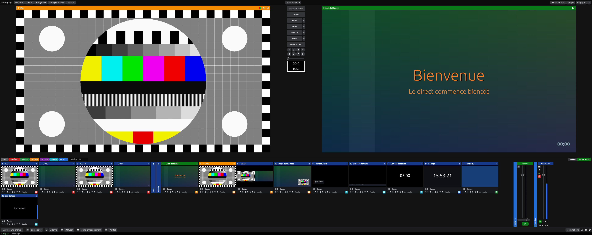

<h1 align="center">LiveCraft</h1>

<p align="center"><strong>A live video production desk, written from scratch in pure Rust.</strong></p>

<p align="center">
  
  
  
  
  
</p>

> [!NOTE]
> **LiveCraft needs you.** It works on one desk today, and it needs people with cameras, capture
> cards, PTZ heads, streaming accounts and real shows to break it. See
> [how to help](#come-build-it-with-us).

<p align="center">
  <a href="#features">Features</a> ·
  <a href="#get-started">Get started</a> ·
  <a href="#come-build-it-with-us">Contribute</a> ·
  <a href="ROADMAP.md">Roadmap</a> ·
  <a href="SECURITY.md">Security</a>
</p>



### 🎛️ Familiar by design

Preview on the left, output on the right, transitions between them, input cards and an audio mixer
below. If you have run a live show on a software mixer, you already know where everything is.

### 📂 Opens your existing shows

LiveCraft reads `.vmix` project files: inputs, scenes and layers, overlays, tabs, colour settings, LUTs,
audio routing and the state you left them in. Your file is never changed; you save a new `.livecraft`.

### ⚡ Light on purpose

What nobody is watching costs next to nothing. Cards are drawn at card size, pages off air slow down
on their own, and all web inputs share a single browser.

### 🔌 Scriptable from the start

One list of named functions sits behind the buttons, shortcuts, triggers, scripts and remote control.
The HTTP and TCP interfaces use the published function names, so existing control surfaces can connect.

## Features

**Inputs.** Video files, image sequences, photo folders, lists, images, audio files, cameras and
microphones, screen capture, system audio, network streams (SRT, RTMP, RTSP, TS), web pages, solid
colours, test cards, clocks, and titles with presets, tickers, countdowns and a simple designer.

**Switching.** Cut, fade, zoom, wipes, slides, the cube family, merge and stingers, with four
transition slots, a T-bar, fade to black and Quick Play.

**Layers and overlays.** Scenes with layers, eight overlay channels that remember what they showed,
picture-in-picture with borders, and a second mixer as an input.

**Picture.** Colour correction, chroma, luma and colour keys, LUTs (`.cube` and PNG), blur, sharpen
and alpha masks, plus scopes and safe areas.

**Audio.** Master and buses A to G, per-input gate, compressor, ten-band EQ, delay, solo and
headphones, with several output devices.

**Outputs.** Two recorders, up to five stream destinations sharing one encode, separate recordings per
input, SRT output, fullscreen and external windows, multiview. NVENC, Quick Sync and AMF are used when
your FFmpeg offers them.

**Show tools.** Instant replay with events and tags, playlists, triggers, data sources from CSV,
scripts, VISCA PTZ control, a telestrator, and a web controller for phones and tablets.

## Get started

You need [Rust](https://rustup.rs) (edition 2024), and [FFmpeg](https://ffmpeg.org) on your `PATH`. Web
inputs also need Edge or Chrome. Builds target CPUs with AVX2, see `.cargo/config.toml`.

```sh
cargo run --release
```

Other ways to start it:

```sh
livecraft --project show.vmix             # open a project
livecraft --import-report show.vmix       # say what a project keeps, without opening it
livecraft --selftest some-folder          # real end-to-end run: plays, records, streams, replays
livecraft --livecheck some-folder         # virtual camera and microphone, streamed and read back
livecraft --screenshot out.png            # start, save a picture of the window, quit
livecraft --lang en                       # start in English (or fr), and keep that choice
```

> [!IMPORTANT]
> LiveCraft is **early alpha and not ready for a show that matters.** It has run on one Windows machine.
> Tests cover the desk, the interface and real encoding to local files and a local stream, but it has
> **not** been tried with physical cameras, capture cards, PTZ heads or a live streaming platform.
> The interface speaks French and English: it follows the system language, and Settings › Options
> changes it.

### What is missing today

- **Windows only.** The code uses Windows APIs for capture, screens and secrets.
- **The picture is composed on the CPU.** It holds 1080p on a desktop processor; 4K will be heavy.
- **No NDI or OMT.** Also no video calls, no PowerPoint or DVD inputs, no virtual sets.
- **Animated title templates are not imported.** Their text comes across on a simple remade title.

The full list is in the [roadmap](ROADMAP.md).

### Live check

`--livecheck` runs the path of a real show through devices Windows sees as real. A
[Softcam](https://github.com/tshino/softcam) virtual camera shows a counting pattern and
[VB-CABLE](https://vb-audio.com/Cable/) carries a 1 kHz tone; LiveCraft opens them as a camera and a
microphone, streams program over RTMP and SRT to its own [MediaMTX](https://github.com/bluenviron/mediamtx)
on free local ports, then reads both streams back and checks that the count keeps moving and the tone
is there. CI runs it on every pull request, along with three deliberately broken runs
(`--break freeze`, `--break silence`, `--break drop`) that must fail.

To run it yourself, install VB-CABLE once (it needs an administrator and plays the tone into
`CABLE Input` while the check runs), then fetch the other tools with Visual Studio or its Build Tools
installed:

```powershell
./scripts/livecheck-tools.ps1     # prints LIVECRAFT_MEDIAMTX=... and LIVECRAFT_SOFTCAM=...
$env:LIVECRAFT_MEDIAMTX = '<printed path>'; $env:LIVECRAFT_SOFTCAM = '<printed path>'
cargo run -- --livecheck target/livecheck
```

Softcam is registered for the current user only while the check runs, so no administrator is needed
for it. Close other programs using a Softcam camera first: only one can exist at a time.

## Come build it with us

Contributions of every size are welcome, in English or in French. You do not need to write code:

- 🎥 **Try it with real gear** and tell us what happens. This is the most useful thing right now.
- 🐛 **Open an issue** with your Windows version, your hardware and what you expected.
- 🌍 **Translate the interface**: a language is one text file in [`locales/`](locales).
- 🦀 **Take something from the [roadmap](ROADMAP.md).** A compositor on the GPU is the biggest one.

Start with [CONTRIBUTING.md](CONTRIBUTING.md). AI coding agents should read [AGENTS.md](AGENTS.md) too.

## Under the hood

Rust with [egui](https://github.com/emilk/egui) for the window, [rayon](https://github.com/rayon-rs/rayon)
for compositing and [cpal](https://github.com/RustAudio/cpal) for sound. FFmpeg runs as a separate
process for each source and output. See [docs/architecture.md](docs/architecture.md).

## Security

The remote control only listens on this computer unless you turn network access on. To report a
vulnerability, see [SECURITY.md](SECURITY.md).

## License and credits

Licensed under either the [MIT License](LICENSE-MIT) or the [Apache License 2.0](LICENSE-APACHE), at
your option. Third-party work is credited in [ATTRIBUTION.md](ATTRIBUTION.md).

LiveCraft is an independent project, built from public documentation. It is not affiliated with or endorsed
by the makers of vMix or any other product named here; those names are trademarks of their owners and
appear only to describe compatibility.
